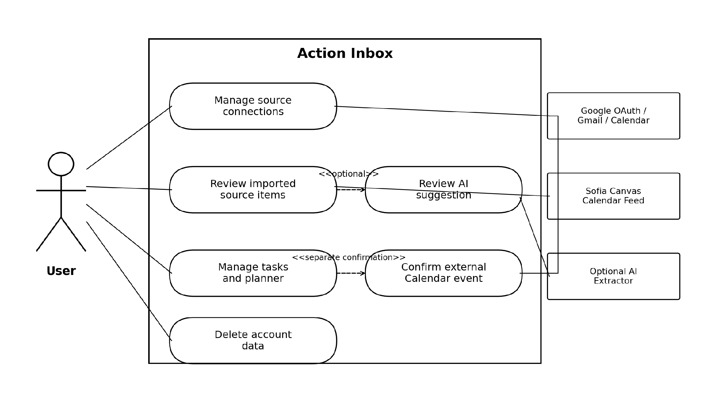
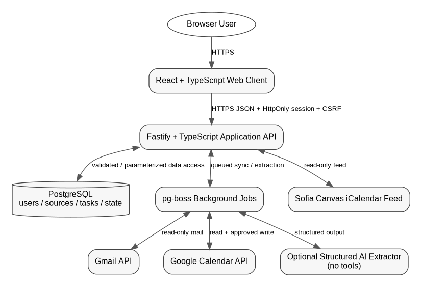

> Source: [SRS v2.0](https://drive.google.com/file/d/1cOKQWf7hR-8iwY16GdrWlW-PMErboUx8/view), modified November 1, 2026; text and figures synchronized November 14, 2026. This is the current course requirements baseline.
>
> Keep SRS version-qualified FR/SEC/NFR references separate from the engineering AC/P2 identifiers in [EXECUTION_PLAN.md](../../EXECUTION_PLAN.md) and [Phase 2 requirements](phase-2.md). Current-status note (November 22, 2026): under the user's delegated finalization decisions, AC-09 aligns with this SRS's FR17 and the submitted STP: persistent create/edit/cancel reminder metadata for owned approved/manual tasks, clearly labelled as no delivery. Notification delivery is outside this release and retains separate future permission/evidence requirements. This note does not alter the historical imported requirements or fabricate past acceptance. Real-model, four-user, HTTPS and non-developer evidence gaps remain in [P0 evidence](../testing/p0-evidence.md). The [human-approval ADR](../adr/course-0001-human-approval-boundary.md) retains its original SRS v1 references.

**Software Requirements Specification**

Action Inbox - Version 2.0

MSCS2101 Software Engineering | Group 1

Date: November 1, 2026

Team: Ziruo Ke, Ke Ding, Jiaqi Zhou, Tianchu Hang

# Document Control

| **Version** | **Date**         | **Change summary**                                                                                                                                                                                                                                                                                     | **Reason**                                                                                                                                                                       |
| ----------- | ---------------- | ------------------------------------------------------------------------------------------------------------------------------------------------------------------------------------------------------------------------------------------------------------------------------------------------------ | -------------------------------------------------------------------------------------------------------------------------------------------------------------------------------- |
| 1.0         | October 2026     | Initial requirements baseline for the PDR.                                                                                                                                                                                                                                                             | Established the first project scope and requirements.                                                                                                                            |
| 2.0         | November 1, 2026 | Added use-case and system-design diagrams; aligned requirements with the browser-first implementation; clarified Gmail, Google Calendar, and read-only Canvas behavior; made NFRs measurable; strengthened security/privacy requirements; updated traceability; clarified reminder and AI limitations. | PDR feedback requested use-case/system-design visibility, and implementation work exposed scope, security, resilience, and provider-boundary details that needed to be explicit. |

# 1. Introduction

## 1.1 Purpose

This Software Requirements Specification defines the version 2.0 requirements for Action Inbox, a browser-based source-linked planner. It is intended for the project team, instructor/reviewers, testers, and any AI coding assistant used during implementation. The document states what the system shall do, the limits of the MVP, and the measurable conditions used to verify the system.

## 1.2 Scope

Action Inbox helps students and busy professionals manage responsibilities that are scattered across email, calendars, coursework, and manually created tasks. The MVP connects consented Google data and a read-only Sofia Canvas calendar feed to one internal planner. Gmail messages remain readable even when AI extraction is unavailable. AI, when explicitly configured, may propose actions and deadlines with supporting evidence, but the user remains the final decision maker. A proposal is not an approved task, and an approved task is not permission to create an external calendar event.

- Core sources: Google sign-in, Gmail read-only import, Google Calendar read/display and user-confirmed event creation, and a read-only Sofia Canvas Calendar Feed.
- Core workflow: source import -> review -> optional evidence-backed suggestion -> user edit/approve/reject -> internal task -> optional separately confirmed Google Calendar event.
- Planner: internal agenda/calendar, source filters, task states, and a persistent 7-day, 30-day, or custom 1-365-day display window.
- Out of scope for the current MVP: automatic email sending, Canvas submissions or grades, full Canvas OAuth, Outlook integration, attachment/OCR deadlines, bidirectional task sync, public app distribution, and unverified notification delivery.

## 1.3 Definitions, Acronyms, and Abbreviations

| **Term**       | **Definition**                                                                                         |
| -------------- | ------------------------------------------------------------------------------------------------------ |
| Action Inbox   | The project web application defined by this SRS.                                                       |
| EARS           | Easy Approach to Requirements Syntax.                                                                  |
| PDR            | Preliminary Design Review.                                                                             |
| NFR            | Non-functional requirement.                                                                            |
| OAuth          | Authorization protocol used for consented Google access.                                               |
| Source item    | Imported Gmail message, Canvas feed item, Google Calendar event, or manual item shown in the planner.  |
| Suggestion     | A reviewable proposed action produced from a source item; it is not yet a task.                        |
| Task           | An app-owned action created manually or after explicit approval.                                       |
| Native date    | A date/time provided by the source system instead of inferred by AI.                                   |
| Evidence quote | A quotation verified to occur in the normalized source text and displayed to support an AI suggestion. |

## 1.4 References

- Ian Sommerville, Software Engineering, 10th ed., Chapter 4 (Requirements Engineering), Chapters 5-7 (modeling, architecture, design).
- IEEE Std 830-1998 SRS structure used by the course.
- Action Inbox Project Proposal and PDR presentation, Group 1.
- Action Inbox repository execution plan, architecture notes, and current implementation evidence.

## 1.5 Overview

Section 2 describes the product, actors, scope, and architecture. Section 3 gives testable EARS requirements, measurable NFRs, security requirements, constraints, and traceability. The appendices record AI assistance and the architecture-decision update introduced by the Canvas calendar-only integration.

# 2. Overall Description

## 2.1 Product Perspective

Action Inbox is a browser-first application with a React/TypeScript client, a Fastify/TypeScript API, PostgreSQL persistence, background job processing, provider connectors, and an optional structured AI extraction boundary. The system is intentionally not a replacement for Gmail, Google Calendar, or Canvas. It adds a source-linked review and planning layer across them.

## 2.2 Product Functions

- Authenticate users with Google and maintain a secure application session.
- Import a bounded Gmail window and preserve source identity and source links.
- Display source messages regardless of whether AI extraction is enabled.
- Optionally produce evidence-backed action/deadline suggestions from Gmail.
- Allow users to edit, approve, reject, or ignore suggestions before task creation.
- Create and manage internal tasks with Pending, Waiting for Reply, and Completed states.
- Display Google Calendar events and create an event only after explicit confirmation.
- Connect a read-only Sofia Canvas Calendar Feed and import its native dated items.
- Filter planner items by source and use a saved display window.
- Retain last-success data and expose retryable errors when an external source fails.
- Disconnect sources and delete retained application data under user control.

## 2.3 Use-Case Diagram

The PDR feedback asked for a use-case or system-design view. Figure 1 shows the main user actions and external systems. The important control boundary is that review/approval occurs before task creation, and a second confirmation occurs before an external Calendar write.

_Figure 1. Action Inbox use-case view._

## 2.4 System Design Diagram

Figure 2 shows the main runtime components. Provider credentials and user ownership are enforced server-side. The optional AI extractor has no tools and cannot directly create tasks or external events.

_Figure 2. High-level system architecture._

## 2.5 User Characteristics

- Primary users are students and busy professionals who already use email, calendars, or course systems.
- Users are expected to understand ordinary browser login/consent screens but are not expected to understand APIs, OAuth, or AI models.
- The classroom MVP is intended for four approved test users rather than public release.

## 2.6 Constraints

- Browser-first delivery; native mobile/Expo development is outside the revised platform scope.
- Gmail import is bounded to the latest 14 days and at most 100 messages per run.
- Google access uses approved OAuth test users and least-privilege scopes.
- The Sofia Canvas connection is calendar-feed only; it does not provide grades, submissions, authoritative completion state, or complete coursework coverage.
- Paid AI extraction is disabled unless separate API configuration and cost approval are available.
- Reminder controls represent durable reminder metadata only until a real notification channel is approved and verified.

## 2.7 Assumptions and Dependencies

- Google test-mode OAuth, Gmail API, and Google Calendar API remain available to approved test users.
- Users provide their own private Sofia Canvas Calendar Feed link through the authenticated application interface.
- The system depends on PostgreSQL and supported Node/browser versions described in the project repository.
- External providers may fail or return incomplete/bounded data, so the product must distinguish last-success data from current refresh status.

# 3. Specific Requirements

## 3.1 External Interface Requirements

### 3.1.1 User Interface

**UI-01 [Ubiquitous]** The Action Inbox web client shall provide signed-in views for Connections, Inbox/source evidence, Tasks, and Planner.

**UI-02 [Event-driven]** When a user changes the display window to 7 days, 30 days, or a custom value from 1 to 365 days and applies it, the system shall persist the setting for that account and display the effective date range and browser timezone.

**UI-03 [Unwanted behavior]** If a source refresh or save fails, then the system shall display a user-readable retryable error and shall keep the last successful data visible.

### 3.1.2 Software and Communication Interfaces

**IF-01 [Ubiquitous]** The system shall communicate between the browser and application API over HTTPS outside local development.

**IF-02 [Optional]** Where Google integration is enabled for an approved test user, the system shall use backend-owned OAuth to access Gmail read-only data and the Calendar capabilities required by this SRS.

**IF-03 [Optional]** Where a Sofia Canvas calendar subscription is connected, the system shall read only the approved HTTPS user-calendar feed and shall not write to Canvas.

**IF-04 [Optional]** Where AI extraction is configured and authorized, the system shall exchange schema-constrained text input/output through an Extractor interface that has no application-action tools.

## 3.2 Functional Requirements

### 3.2.1 Authentication and Source Connections

**FR-01 [Event-driven]** When an unauthenticated user selects Google sign-in, the system shall start a backend OAuth flow that binds state to the initiating browser session and returns the user only to the configured application origin.

**FR-02 [Event-driven]** When Google OAuth completes successfully, the system shall create or rotate an opaque HttpOnly application session and shall store provider tokens only on the server.

**FR-03 [Event-driven]** When a signed-in user disconnects Google, the system shall invalidate the local Google connection and stop future Google synchronization while leaving a separately connected Canvas source unchanged.

**FR-04 [Event-driven]** When a signed-in user requests account-data deletion, the system shall remove the user-owned retained source data, tasks, connection records, and application sessions according to the project retention rules.

### 3.2.2 Gmail Import and Source Review

**FR-05 [Event-driven]** When a connected user starts Gmail synchronization, the system shall import at most 100 messages from the most recent 14-day import window and shall record a synchronization status.

**FR-06 [Ubiquitous]** The system shall uniquely identify a Gmail message by user ownership and provider message identity so that repeated synchronization does not create duplicate stored messages.

**FR-07 [Event-driven]** When a user opens an imported Gmail item, the system shall display the stored sender, subject, received time, normalized readable body, source linkage, and current extraction state available to that user.

**FR-08 [Unwanted behavior]** If Gmail synchronization fails after earlier successful imports, then the system shall retain the earlier imported messages and shall expose the failed run as retryable instead of reporting silent success.

### 3.2.3 AI Suggestions and Human Review

**FR-09 [Optional]** Where an authorized extractor is enabled, when a Gmail item is processed, the system shall request structured output containing a supported category, action fields, deadline certainty, confidence, and supporting quotation.

**FR-10 [Event-driven]** When an AI-derived action or deadline is accepted for display as supported, the system shall verify that its evidence quotation occurs in the normalized source body.

**FR-11 [Unwanted behavior]** If an extracted deadline is relative, ambiguous, unsupported, or cannot be defensibly resolved with the reference time and timezone, then the system shall mark the deadline for user review rather than silently treating it as exact.

**FR-12 [Event-driven]** When a user reviews a proposed suggestion, the system shall allow the user to edit it, approve it, or reject it before it becomes an internal task.

**FR-13 [Unwanted behavior]** If AI extraction is unavailable or disabled, then the system shall keep the imported Gmail message readable and shall not invent an action or deadline.

### 3.2.4 Internal Tasks and Reminder Metadata

**FR-14 [Event-driven]** When a user explicitly approves a suggestion, the system shall create at most one corresponding internal task and shall preserve the source link to the originating item.

**FR-15 [Event-driven]** When a user creates a manual task, the system shall store it as an app-owned task without requiring a source email or AI output.

**FR-16 [Event-driven]** When a user changes a task status, the system shall support Pending, Waiting for Reply, and Completed states and shall persist the new state.

**FR-17 [Event-driven]** When a user adds, edits, or cancels a reminder for a task, the system shall persist the reminder metadata and shall label it as in-app scheduling metadata unless an independently verified delivery mechanism exists.

### 3.2.5 Planner and Google Calendar

**FR-18 [Event-driven]** When a signed-in user opens the Planner, the system shall display dated tasks and supported source items within the selected display window and shall keep undated work visible in a separate undated/review area.

**FR-19 [Event-driven]** When a user selects a Planner source filter, the system shall allow All, Gmail, Canvas, Google Calendar, and Manual task views without changing source retention or import coverage.

**FR-20 [Event-driven]** When Google Calendar data is available, the system shall display upcoming provider events as external events distinct from internal tasks and proposed suggestions.

**FR-21 [Event-driven]** When a user separately confirms creation of a Google Calendar event for an approved task, the system shall create the event once, persist the provider event identifier, and link it to the task.

**FR-22 [Unwanted behavior]** If Calendar event creation is retried after an uncertain or failed response, then the system shall reuse its idempotency identity and shall not create a duplicate external event.

### 3.2.6 Sofia Canvas Calendar Feed

**FR-23 [Event-driven]** When an authenticated user submits a supported Sofia Canvas Calendar Feed URL, the system shall validate the source, encrypt the secret subscription value server-side, clear it from the user interface, and perform an initial read-only import.

**FR-24 [Event-driven]** When a connected Canvas user requests Refresh, the system shall import the supported bounded calendar snapshot and shall preserve native assignment due dates separately from event start/end times.

**FR-25 [Unwanted behavior]** If a Canvas item supplies only a date and no exact due time, then the system shall display it as date-only and shall not invent an exact clock time.

**FR-26 [Unwanted behavior]** If a Canvas refresh fails, then the system shall retain the last successful Canvas snapshot and display a retryable source-specific error.

**FR-27 [Unwanted behavior]** If a Canvas feed contains more than 1,000 imported events in the supported snapshot, then the system shall reject the refresh with a clear error rather than silently truncating the data.

**FR-28 [Event-driven]** When a user disconnects Canvas, the system shall delete the locally stored Canvas feed secret and imported Canvas items without changing the user's Canvas account.

## 3.3 Measurable Non-Functional Requirements

| **ID**                     | **EARS requirement**                                                                                                                                                                            | **Measure / acceptance**                                                              |
| -------------------------- | ----------------------------------------------------------------------------------------------------------------------------------------------------------------------------------------------- | ------------------------------------------------------------------------------------- |
| NFR-01 Performance         | When the designated demo browser loads a populated dashboard with 100 synchronized messages and API data is available, the system shall become interactive within 2 seconds.                    | Measured in the designated demo browser; target <= 2.0 s after API data availability. |
| NFR-02 Accuracy - action   | When the frozen anonymized 50-message evaluation set is scored by the approved extraction configuration, the system shall achieve at least 90% recall for messages labelled Action Required.    | Recall >= 0.90; misses documented.                                                    |
| NFR-03 Accuracy - deadline | When explicit deadlines in the frozen evaluation set are scored, the system shall achieve at least 90% precision for extracted explicit deadlines.                                              | Precision >= 0.90; ambiguous/unsupported dates must be review state.                  |
| NFR-04 Idempotency         | When the same Gmail synchronization is run three times on unchanged source data, the system shall store one copy of each email and at most one active suggestion for the same extracted action. | Three-run duplicate test passes.                                                      |
| NFR-05 Resilience          | If Gmail, Calendar, Canvas, or AI processing fails after a successful state exists, then the system shall keep the last successful data readable and expose a retryable error.                  | Failure-injection tests preserve last-success data.                                   |
| NFR-06 Usability           | When a non-developer team member performs the primary workflow on the designated build, the system shall allow completion without developer coaching.                                           | One documented usability run completes the connect/review/task flow without coaching. |
| NFR-07 Traceability        | For every P0 requirement, the project shall maintain at least one mapped test or acceptance check and one final-report/design reference.                                                        | Traceability matrix has no unmapped P0 requirement.                                   |

## 3.4 Security and Privacy Requirements

**SEC-01 [Ubiquitous]** The system shall enforce per-user ownership on every protected source item, suggestion, task, reminder, calendar link, and connection record using the authenticated server-side user identity.

**SEC-02 [Ubiquitous]** The system shall encrypt Google provider tokens, PKCE material, and the private Canvas subscription secret at rest using deployment-managed encryption material stored outside the database.

**SEC-03 [Ubiquitous]** The system shall not write authorization headers, session cookies, OAuth codes, provider tokens, private Canvas feed URLs, raw email bodies, or AI prompts containing private email text to application logs.

**SEC-04 [Event-driven]** When a browser sends a state-changing request, the system shall require an authenticated session, a valid session-bound CSRF token, and an allowed exact Origin.

**SEC-05 [Unwanted behavior]** If a request attempts to access or modify an object owned by another user, then the system shall deny the request without returning the other user's private content.

**SEC-06 [Ubiquitous]** The system shall treat imported email and Canvas text as untrusted input and shall not give the AI extractor tools or permission to execute application actions.

**SEC-07 [Unwanted behavior]** If AI output proposes an action or deadline, then the system shall store it only as reviewable data and shall not create an internal task or external Calendar event solely from model output.

**SEC-08 [Event-driven]** When the user disconnects or deletes retained source data, the system shall remove the corresponding local credentials/content and invalidate the applicable application state according to the selected operation.

## 3.5 Design Constraints

- React + TypeScript + Vite browser client; Node.js + TypeScript + Fastify API; PostgreSQL persistence; shared runtime-validated contracts.
- Google provider access is backend-owned; provider bearer tokens are not stored in browser JavaScript storage.
- AI output is schema-constrained and passes application validation before display/use.
- Database access uses parameterized queries/ORM behavior and uniqueness constraints for idempotency.
- GitHub Quality gate runs type checking, linting, formatting, PostgreSQL-backed tests, and an isolated web build before merge.

## 3.6 Requirements Traceability Matrix

| **Requirement(s)**  | **Design / component**                                               | **Verification / evidence**                                            |
| ------------------- | -------------------------------------------------------------------- | ---------------------------------------------------------------------- |
| FR-01-04, SEC-01-05 | Auth/session/connection services; OAuth boundary                     | AC-01, AC-11; OAuth misuse and ownership tests                         |
| FR-05-08, NFR-04    | Gmail adapter, sync jobs, email persistence                          | AC-02, AC-03, AC-12; repeated-sync integration test                    |
| FR-09-13, SEC-06-07 | Extractor interface, evidence validator, review UI                   | AC-05, AC-06, AC-10; frozen 50-message evaluation                      |
| FR-14-17            | Task/reminder services and task UI                                   | AC-04, AC-07, AC-09; task-state tests                                  |
| FR-18-22            | Planner and Google Calendar adapter                                  | AC-08; planner/filter tests; calendar retry/idempotency test           |
| FR-23-28, SEC-02-03 | Canvas feed adapter, encrypted connection storage                    | Canvas connect/refresh/disconnect tests; failed-refresh retention test |
| NFR-01              | Web dashboard and API response path                                  | AC-13 performance measurement                                          |
| NFR-02-03           | Evaluation harness and versioned anonymized dataset                  | AC-10 precision/recall report                                          |
| NFR-05              | Source adapters and last-success state                               | AC-12 failure/retry tests                                              |
| NFR-06              | Primary user flow                                                    | Non-developer usability session                                        |
| NFR-07              | SRS, tests, design docs, final report                                | AC-14 traceability review                                              |
| SEC-01-08           | Security boundary, encrypted secrets, logging policy, approval gates | AC-04, AC-11; security review and negative tests                       |

# 4. PDR Feedback and Version 2.0 Changes

The PDR feedback specifically requested a use-case or system-design diagram. Version 2.0 adds both views and uses them to make the user-control and external-service boundaries visible. The revision also incorporates implementation feedback from the vertical slice and provider work:

- Clarified that the first Canvas integration is a read-only calendar subscription, not full Canvas course/grade/submission access.
- Clarified that reminder controls currently persist metadata; delivered notification transport is not claimed until separately implemented and observed.
- Sharpened Gmail import bounds, duplicate-prevention behavior, last-success failure behavior, and date-only Canvas semantics.
- Added measurable accuracy, performance, resilience, usability, and traceability NFRs.
- Added explicit security requirements for ownership, encryption, logging, CSRF/origin enforcement, untrusted source text, AI tool isolation, and human approval.

# Appendix A - AI Assistance & Provenance

Generative AI was used as a drafting and review aid for requirements organization, EARS wording, diagram drafting, traceability checks, risk brainstorming, and consistency review. The team remains responsible for every requirement. AI-produced wording was checked against the PDR feedback, the approved project proposal, the current repository behavior, and the project execution plan. The team specifically rejected or corrected any wording that implied full Canvas access, automatic task/event creation, delivered reminders, or established model accuracy when those claims were not supported by the implementation or test evidence. No credentials, private feed URLs, raw private email content, or non-anonymized user data are included in this document.

# Appendix B - Architecture Decision Update

## ADR-0002: Use a Read-Only Sofia Canvas Calendar Feed for the First Canvas Integration

Status: Under Discussion for the current MVP design.

Related requirements: FR-23 through FR-28, SEC-02, SEC-03, NFR-05.

Context: Full Canvas OAuth requires institutional application credentials and broader permission. The course project needs useful native assignment/event dates without claiming access to grades, submissions, completion status, or the full Canvas API.

Decision: The first Canvas integration will accept the user's private Sofia Calendar Feed through authenticated app input, validate the supported source, encrypt the subscription secret server-side, import native dates in a bounded read-only snapshot, and require explicit manual refresh. It will not write to Canvas or create tasks/events automatically.

Alternatives considered: (1) Full Canvas OAuth - deferred because institutional registration/permissions are not yet available. (2) Browser scraping - rejected because it is fragile and violates the project's provider-access boundary. (3) No Canvas support - rejected because the calendar feed provides useful native dates within a narrower, honest scope.

Consequences: Positive - useful coursework dates can enter the planner without AI, with a smaller authorization surface. Negative - the feed is bounded and cannot provide grades, submission state, authoritative completion, undated work, or full To Do coverage. Follow-up - full Canvas OAuth remains a later decision and must not silently replace this boundary.

AI assistance: AI was used to compare integration options and draft wording. The team selected the read-only boundary and verified it against the actual Sofia feed behavior and project security constraints.
